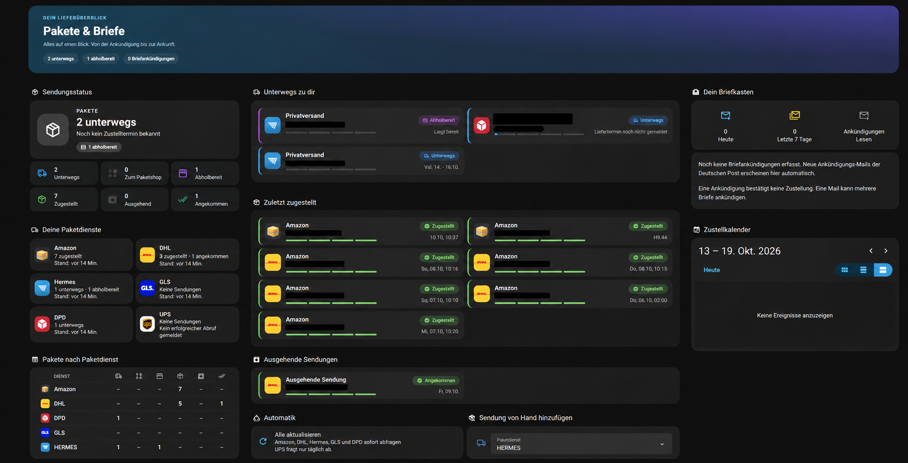
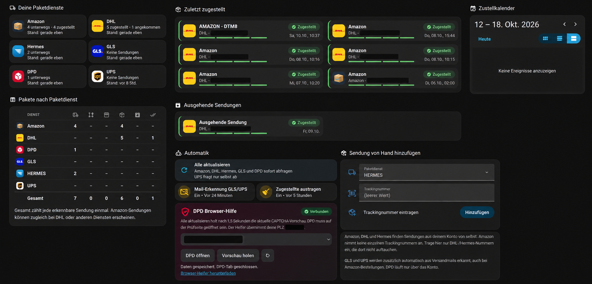
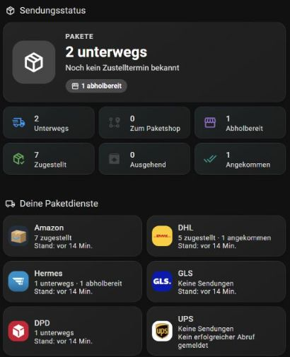
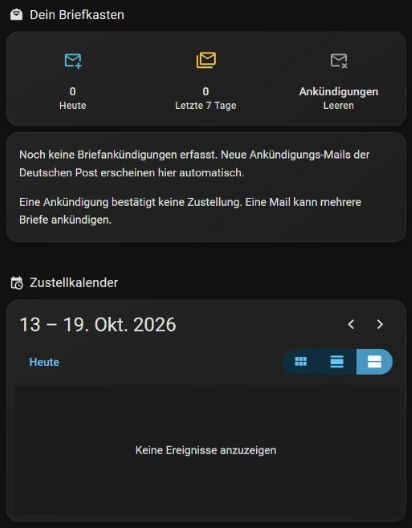
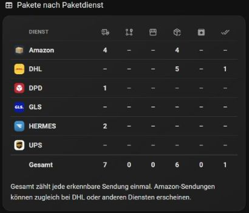

# Pakete & Briefe für Home Assistant

Privates Projekt für das individuell erweiterte Paket-Dashboard. Dieser Stand wurde am **20. Oktober 2026** aus der laufenden Home-Assistant-Installation und den zugehörigen Arbeitsdateien zusammengeführt.

**Erstellt mit GPT-6.1 Sol · Denkaufwand: Gering.** Die gesamte eigene Umsetzung – Dashboard-Gestaltung, Jinja-Anpassungen, Automationen, Skripte, Mail-Erweiterungen und DPD-Browser-Hilfe – entstand mit dieser Unterstützung in Codex. Die verwendeten Fremdintegrationen und ihre ursprünglichen Autoren sind unter [Herkunft](#herkunft) und in [THIRD_PARTY.md](THIRD_PARTY.md) aufgeführt.

## So sieht es aus

### Große Übersicht



*Vom Nutzer bereitgestellte, KI-bearbeitete Übersicht ohne Seitenleiste. Sie dient zur Veranschaulichung der Gestaltung und ist kein pixelgenauer Screenshot; einzelne Texte und Zahlen können abweichen.*

### Unterer Bereich: Automatik und DPD-Browser-Hilfe



*Ergänzende, KI-anonymisierte Ansicht mit vollständigem unteren Bereich: Dienstetabelle, Automatik, DPD-Browser-Hilfe einschließlich Abschlussmeldung sowie manuelles Hinzufügen. Persönliche Nummern und PLZ sind geschwärzt. Auch diese Darstellung ist illustrativ und kein pixelgenauer Screenshot.*

### Echte Detailaufnahmen

Echte Ausschnitte aus bisherigen Entwicklungsständen des Dashboards. Die Auswahl zeigt keine persönlichen Sendungsnummern oder Adressen. Zähler, Termine und Verbindungsstatus sind Momentaufnahmen und keine Aussage über den aktuellen Betrieb. [Hinweise zu den Aufnahmen](docs/screenshots/README.md).

| Sendungsstatus und Paketdienste | Briefankündigungen und Kalender |
| --- | --- |
|  |  |

### Alphabetische Dienstetabelle



### DPD-Browser-Hilfe

Bedienelemente und Rückmeldung nach dem erfolgreichen Erfassen und Schließen des verwendeten DPD-Tabs:


## Enthalten

- Aktuelles dreispaltiges Dashboard mit kompakten Zählern, zweispaltigen Sendungskarten, Statusfarben, Fortschritt, Tooltips und alphabetischer Dienstetabelle.
- Gemeinsame `pakete.jinja`: Amazon, DHL, DPD, GLS, Hermes und UPS; Dublettenbehandlung, Abholstellen, Liefertermine und Zeiträume, getrennte ein- und ausgehende Sendungen sowie Sortierung zugestellter Sendungen.
- Automationen für Trackingnummern aus Versandmails, Austragen zugestellter Sendungen und Aktualisieren manuell hinterlegter Hermes-Sendungen; Skript zum manuellen Hinzufügen.
- Briefankündigungen aus IMAP-Ereignissen mit Tages-/Wochenzählern und Leeren-Aktion. Gezählt werden Ankündigungs-Mails, nicht zuverlässig einzelne Briefe oder bestätigte Zustellungen.
- `dpd_enrichment`: lokale Absender-Ergänzung aus eindeutig zugeordneten Versandmails und verifizierten DPD-Detailseiten; Mail-Zuordnung auch für UPS und GLS.
- `dpd_assist`, eigene Dashboard-Karte und Chrome-Erweiterung: DPD öffnen, PLZ vorbereiten, Vorschau holen, einzelne Bildhilfe bestätigen, Absender übernehmen und den verwendeten Tab nach erfolgreicher Erfassung schließen.
- Frühere Dashboard-Kopie als **historische Variante**, vorhandene Offline-Tests und relevante Quellcode-Snapshots der Änderungen an Amazon, DHL und Hermes.

## Struktur

| Ordner | Inhalt |
| --- | --- |
| `dashboards/pakete.yaml` | Aktueller Live-Export, ausschließlich Paketansicht |
| `dashboards/variants/` | Frühere Kopie; kein aktueller Live-Stand |
| `custom_templates/` | Gemeinsame Jinja-Makros |
| `custom_components/` | Vollständige eigene Integrationen `dpd_assist` und `dpd_enrichment` |
| `browser-extension/` | Aktueller entpackter Chrome-Helfer aus dem Live-Download |
| `www/pakete/` | Frontend-Karte und Dienstlogos |
| `packages/` | Briefankündigungen und Zusatzkonfigurationen |
| `automations/`, `scripts/` | Ausgewählte aktuelle Definitionen, keine fremden Haus-Automationen |
| `upstream-snapshots/` | Einzelne installierte Dateien der Fremdintegrationen; **keine vollständigen Integrationen** |
| `examples/` | Konfigurationsanschlüsse und Helferdefinitionen |
| `archive/` | Frühere Notizen und separate 17TRACK-Mail-Automation |
| `tests/`, `tools/` | Offline-Prüfungen und Erweiterungs-Build |
| `docs/screenshots/` | Echte Dashboard-Ausschnitte ohne persönliche Sendungsdaten |

## Einrichtung

Siehe [Installation](docs/INSTALLATION.md), [Architektur und Datenfluss](docs/ARCHITECTURE.md) und [Stand und Einschränkungen](docs/STATUS.md).

Dieser Export enthält **keine Passwörter, API-Schlüssel, Home-Assistant-Tokens, Browser-Cookies, echten Mail-Inhalte oder Zustandsdatenbanken**. Mailadresse, HA-Adresse und PLZ wurden durch Beispiele ersetzt. Die bestehende Home-Assistant-Installation wurde beim Export nicht verändert.

Das Repository ist eine versionierte Projektablage, kein vollständiges Home-Assistant-Backup und noch kein HACS-Komplettpaket. Die Integrationen der Paketdienste werden weiterhin separat installiert. Ihre beim Export vorhandenen Versionen stehen in [integration-versions.json](docs/integration-versions.json).

## Offline prüfen

```sh
python -m pip install -r requirements-dev.txt
python tools/validate.py
python tests/test_dpd_assist.py
python tests/test_dpd_enrichment.py
python tests/test_mail_sender.py
node tests/test_dpd_background.cjs
node tests/test_dpd_extension.cjs
python tools/build_extension.py
```

Die Prüfungen lösen kein echtes CAPTCHA und verbinden sich weder mit einem Postfach noch mit DPD. UI- und Schnittstellenänderungen der Paketdienste benötigen zusätzliche Live-Prüfungen.

## Herkunft

Ausgangspunkt war [Sascha Brockels Paket-Tracking-Anleitung](https://sascha-brockel.de/home-assistant-paket-tracking-dhl-hermes-gls-co/). Die Paketdienst-Integrationen stammen aus [ha-parcel-integrations](https://github.com/ha-parcel-integrations). Eigene Erweiterungen und Gestaltung sind hier zusammengeführt. Fremdcode und Logos behalten ihre jeweiligen Rechte; siehe [THIRD_PARTY.md](THIRD_PARTY.md).
